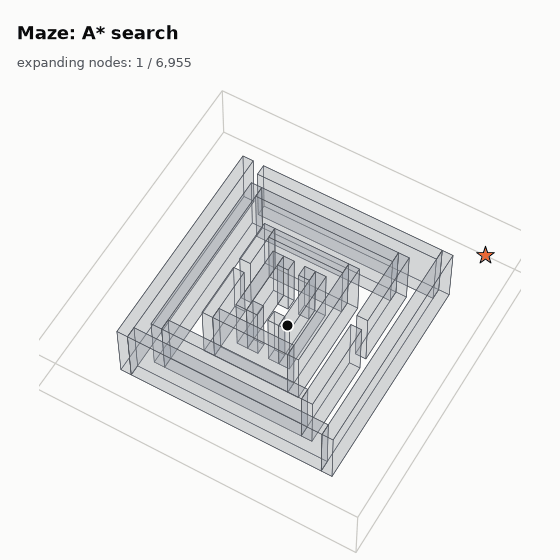
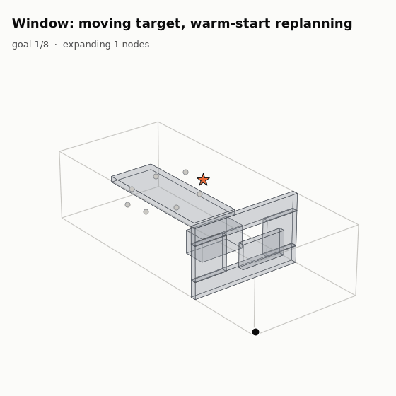
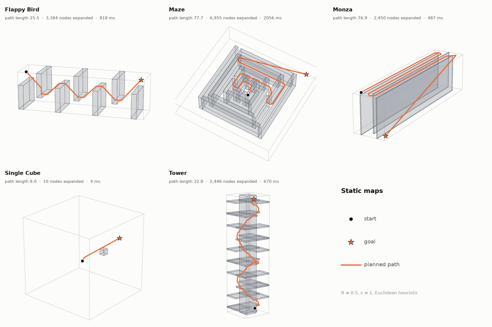
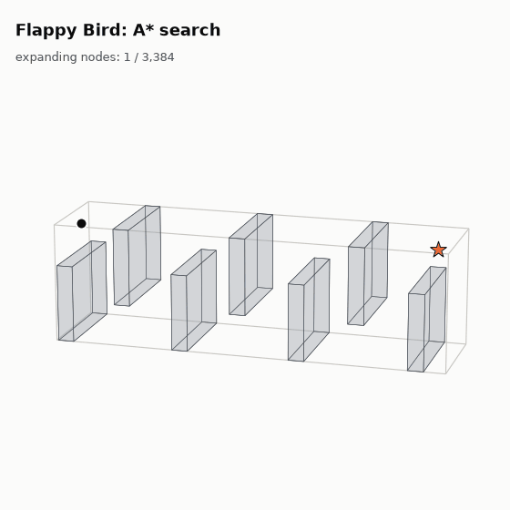
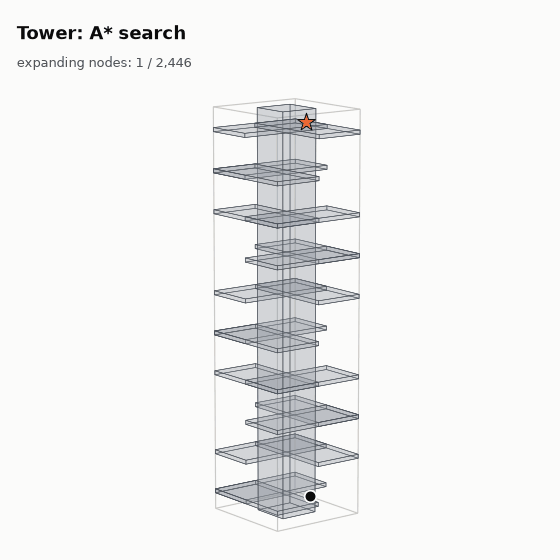
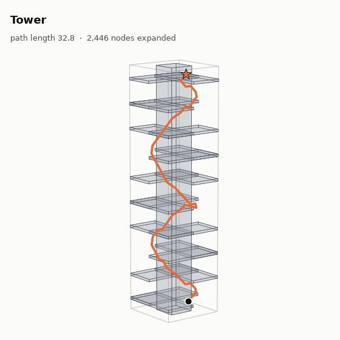
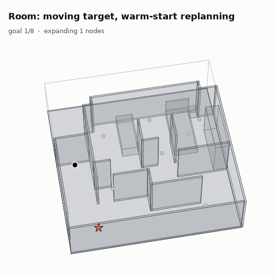
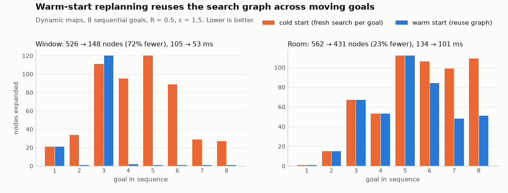
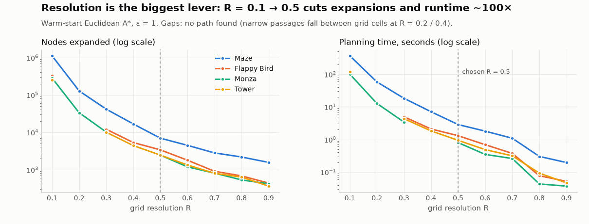
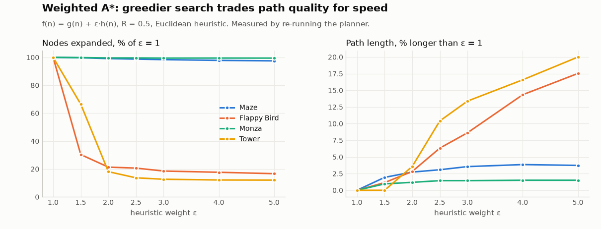

# 3D Path Planning with Weighted A*

A search-based motion planner that finds collision-free paths through 3D environments full of box-shaped obstacles. It handles both fixed goals and **moving targets**. For moving targets, a *warm-start* variant of A* reuses earlier search work, so each replan takes milliseconds.

  
  

<b>Left:</b> A* searching a 3D maze. Blue dots are expanded nodes (darker = more recent); orange is the final path. <b>Right:</b> replanning to a target that moves through 8 positions; each new path is found in milliseconds.

---

## Highlights

- **Solves all 7 benchmark environments**: 5 with a fixed goal and 2 with a moving target. Every path is checked to be collision-free along its full length.
- **Exact collision checking.** Each motion is tested as a continuous line segment against every obstacle, not just at grid points, so the path can't clip a corner or slip through a thin wall.
- **Vectorized collision checks.** All 26 candidate moves from a node are tested in one batched operation. This cut function calls from about 22M to about 4M on the largest maps.
- **Line-of-sight shortcut.** The search ends as soon as the exact (off-grid) goal is directly visible. That gives an exact endpoint and fewer expansions.
- **Warm-start replanning** for moving targets reuses the search graph between goals. On the *Window* map it expands **72% fewer nodes** than starting each search from scratch.
- **Comfortably real-time.** Following all 8 moving goals takes ≈0.37 s of planning on *Window* (vs. a 10 s budget) and ≈0.29 s on *Room* (vs. 1.0 s).

## How it works

**1. Problem.** The world is a rectangular boundary containing axis-aligned box obstacles. Given a start point and one goal (or a sequence of goals), find the shortest path that stays inside the boundary and never touches an obstacle. Obstacles are inflated by a small safety margin, so the robot is treated as a sphere rather than a point.

**2. Graph.** Space is discretized into a 3D grid with resolution *R*. From any cell the robot can move to any of its **26 neighbours** (straight, 2-axis diagonal or 3-axis diagonal). Each move costs its Euclidean length: *R*, √2·*R* or √3·*R*.

**3. Collision checking.** Each candidate move is a line segment. The **slab method** intersects that segment with every inflated obstacle box. It solves for the interval where the segment lies inside each axis' slab, and reports a hit if the three intervals overlap. Because the boundary is convex, a segment stays inside it whenever both endpoints do.

**4. Search.** Weighted A* expands the node with the lowest *f(n) = g(n) + ε·h(n)*, where *g* is the cost so far and *h* is the straight-line distance to the goal:
- *ε = 1* gives optimal A* on the grid.
- *ε > 1* gives a greedier search that expands fewer nodes but may return a slightly longer path.

When a node can see the goal directly, the planner connects to it with a straight segment and stops.

**5. Moving targets (warm start).** The target moves through a sequence of goals that the planner learns about one at a time. The start and obstacles never change, so the graph explored for earlier goals stays valid. For each new goal the planner:
1. keeps every discovered node and its cost-from-start,
2. recomputes only the heuristic toward the new goal,
3. resumes the search from there.

This is a lightweight cousin of incremental planners like LPA* and D* Lite.

## Results

### Static environments

All five fixed-goal maps are solved at the chosen settings: resolution *R* = 0.5, ε = 1, Euclidean heuristic.

| Map | Path length | Nodes expanded |
|---|---:|---:|
| Single Cube | 8.0 | 10 |
| Flappy Bird | 25.5 | 3,384 |
| Tower | 32.8 | 2,446 |
| Monza | 76.9 | 2,450 |
| Maze | 77.7 | 6,955 |

Search effort tracks how *convoluted* a map is rather than how big it is. *Single Cube* is solved after 10 expansions because the goal is visible almost immediately. *Maze* needs about 7k because every dead end must be ruled out.

  
  
  

Search growth on <i>Flappy Bird</i> and <i>Tower</i>, and a 360° view of the path climbing through <i>Tower</i>.

### Moving targets

On the two dynamic maps the target jumps through 8 positions in turn. The planner never sees future goals; it replans as each one appears (ε = 1.5).

  
  

Warm start pays off most when consecutive goals are close together. On *Window*, 6 of the 8 replans expand **only one or two nodes**, because the new goal is already visible from the existing search tree. On *Room* the goals are scattered behind different walls, so there is less to reuse.

The trade-off is memory and some path quality. The graph keeps growing across queries, and reusing old cost-to-come values can lead to slightly longer paths than a fresh search (about 9% longer in total on *Window*; the same total length on *Room*).

### Parameter studies

**Grid resolution** has by far the largest effect on cost. Going from *R* = 0.1 to 0.5 cuts expansions and runtime by about 100× while paths get only a few percent longer. *R* = 0.5 was chosen as the balance point. The gaps in the chart show a real limitation: at *R* = 0.2 and 0.4, grid points happen to miss the narrow passages on some maps, so the planner is **resolution-complete**, not complete in continuous space.

**Heuristic weight ε** controls the speed/optimality trade-off. On open maps such as *Tower* and *Flappy Bird*, ε = 2 already cuts expansions by about 80% for a path only 3–4% longer. On *Maze* and *Monza* the walls force the search to explore regardless, so a greedier ε helps little.

**Heuristic choice.** An *octile* heuristic, which matches the 26-connected move set exactly, was also tested. It gave the same or slightly longer paths and no consistent speed-up; in the warm-start runs it was often 2–3× slower. The simpler Euclidean distance was kept.

## Takeaways

- No single setting wins on every metric. Finer grids give better paths at a much higher cost, and higher ε is faster but less optimal. The final configuration is *R* = 0.5 and Euclidean *h*, with ε = 1 for static maps and ε = 1.5 for moving targets.
- In a dense 3D grid, collision checking dominates runtime. Batching it and precomputing the move set mattered more than any change to the search itself.
- Reusing the search graph is a cheap, effective way to replan for moving goals when the map is static.

## Report

The full write-up, with the problem formulation, derivations, pseudocode and all result tables, is in **[ECE276B_PR2.pdf](ECE276B_PR2.pdf)**.

*This was a project for UC San Diego's ECE 276B (Planning & Learning in Robotics). The source code is not published.*

## License

Released under the [MIT License](LICENSE).
